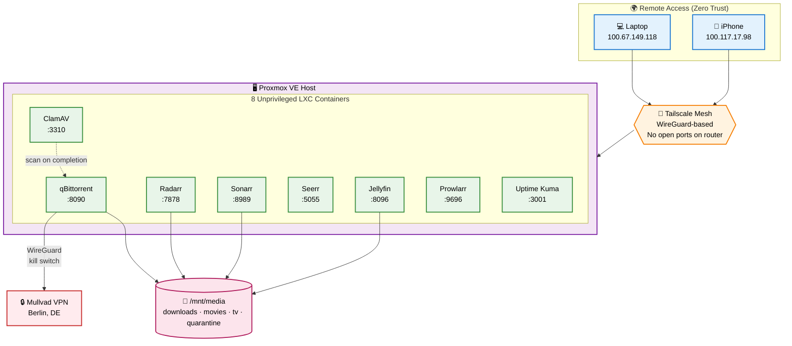
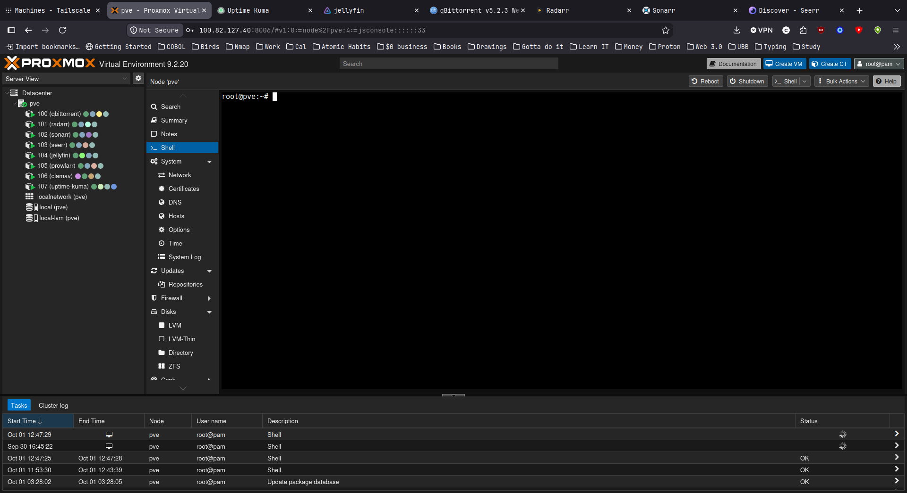
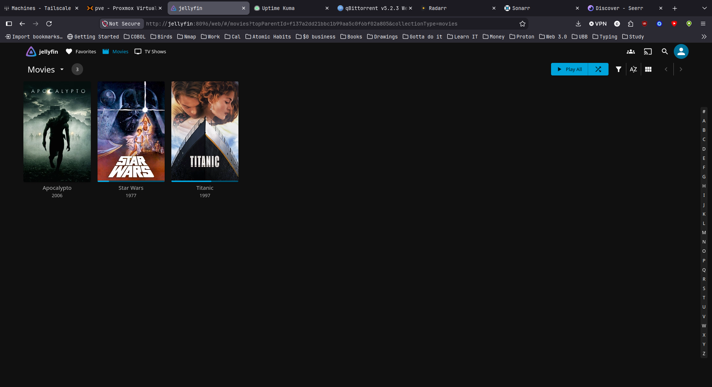
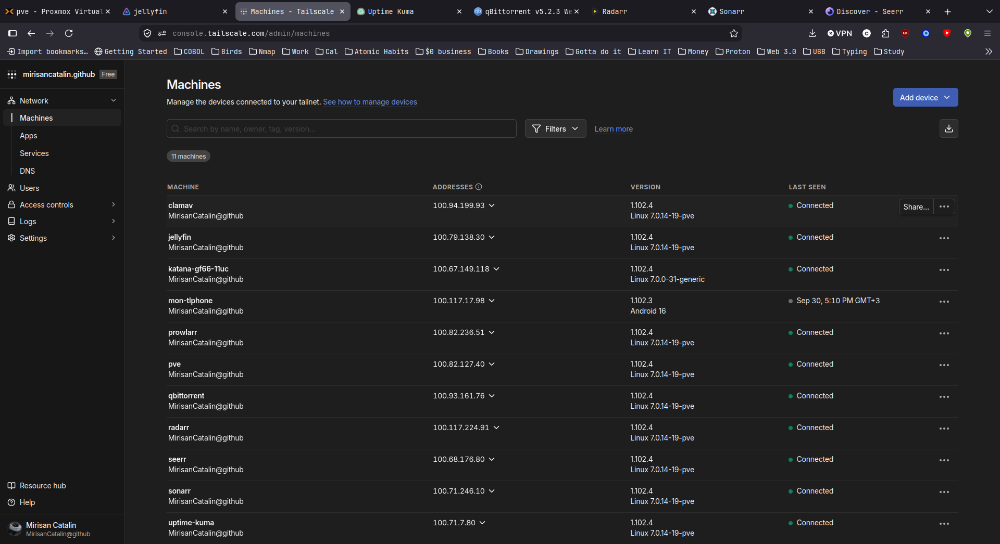
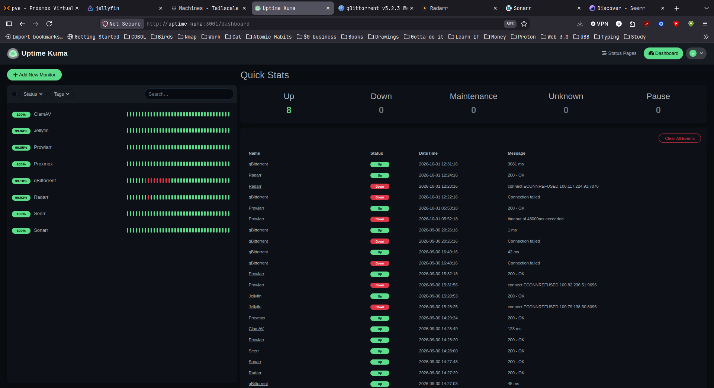
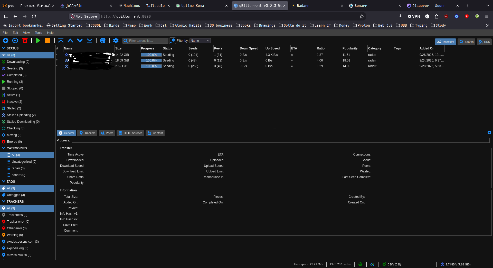

# 🏠 Self-Hosted Media Stack with Zero-Trust Access & Automated Security Scanning

A homelab project built on Proxmox VE, combining a self-hosted media automation
stack with security-first practices: Zero Trust remote access (Tailscale),
VPN-only traffic with kill switch enforcement (WireGuard + Mullvad), and
automated malware scanning (ClamAV) on all incoming files.

Built as a hands-on learning project while studying Cybersecurity / IAM.

## Why this project

Rather than just following a tutorial, this project was designed to practice
core security principles in a real, working environment:

- **Least Privilege** — dedicated non-root admin accounts, unprivileged LXC containers
- **Zero Trust Network Access (ZTNA)** — no open ports on the router; every device
  authenticates individually via Tailscale
- **Defense in Depth** — VPN + firewall kill switch, so a single point of failure
  (VPN drop) doesn't leak traffic
- **Assume Breach** — automated malware scanning on every downloaded file, isolation
  between services via separate containers
- **Network Segmentation** — each service runs in its own container with minimal
  permissions

## Architecture

### Proxmox VE host (192.168.1.50)
- **Hardware:** Lenovo ThinkCentre M720q (i5 Hexa Core, 16GB RAM, 256GB NVMe)
- **OS:** Proxmox VE 9.2.20 (Debian 13 trixie)
- **Firewall:** enabled, security group restricting WebUI to LAN + Tailscale only
- **IPv6:** blocked on all containers (SLAAC disabled via systemd service)

### 8 LXC Containers (all unprivileged)

| ID  | Hostname     | IP             | Role                              | Port  |
|-----|--------------|----------------|-----------------------------------|-------|
| 100 | qbittorrent  | 192.168.1.51   | Torrent client (VPN only)         | 8090  |
| 101 | radarr       | 192.168.1.52   | Movie automation                  | 7878  |
| 102 | sonarr       | 192.168.1.53   | TV automation                     | 8989  |
| 103 | seerr        | 192.168.1.54   | Request management UI             | 5055  |
| 104 | jellyfin     | 192.168.1.55   | Media server (QSV transcoding)    | 8096  |
| 105 | prowlarr     | 192.168.1.56   | Indexer manager                   | 9696  |
| 106 | clamav       | 192.168.1.57   | Antivirus daemon (clamd)          | 3310  |
| 107 | uptime-kuma  | 192.168.1.58   | Service monitoring (Docker)       | 3001  |

### Network architecture

## Security features in detail

### 1. VPN Kill Switch (iptables + routing)

qBittorrent's container routes all traffic through Mullvad VPN. The kill switch
has 3 layers:

1. **iptables:** ACCEPT on `tailscale0` + REJECT for all other non-VPN traffic
   (except local network `192.168.0.0/16` and Tailscale `100.64.0.0/10`)
2. **Routing rules:** `ip rule priority 100` forces Tailscale traffic through
   main routing table
3. **DNS leak protection:** Mullvad DNS (`10.64.0.1`), Tailscale DNS disabled
   in this container

**Verified:** `curl ifconfig.me` returns Mullvad IP; when VPN is down, internet
is completely blocked (`Could not resolve host`).

### 2. Zero Trust Remote Access (Tailscale)

No ports forwarded on the home router. All remote access goes through Tailscale
(WireGuard-based), meaning:
- Every device must be individually authenticated
- No publicly reachable attack surface
- Access from anywhere (university, mobile data, etc.)

**Tailscale ACL ready** for granular control (not yet enforced).

### 3. Automated Malware Scanning (ClamAV)

Every file downloaded by qBittorrent triggers a ClamAV scan **before** it
reaches the media library.

Architecture:
- **Container 106 (clamav)** runs `clamd` daemon on TCP `3310`
- **Container 100 (qbittorrent)** runs `clamdscan` client
- **Script `/opt/scripts/scan-download.sh`** triggered by qBittorrent on torrent
  completion
- Infected files moved to `/mnt/media/quarantine/` with timestamp

**Verified:** EICAR test file detected + quarantined; clean files pass through.

### 4. Least Privilege & Isolation

- **Unprivileged LXC containers** — no root access to the host if a container
  is compromised
- **No SSH** in containers (port 22 closed after audit) — admin via `pct enter`
- **Dedicated non-root Proxmox admin** (`cyberuser@pve`) instead of `root@pam`
- **IPv6 public blocked** on all containers (SLAAC disabled)
- **Firewall security group** restricts Proxmox WebUI to LAN + Tailscale

### 5. Automated Backups & Updates

- **Backups:** weekly `vzdump` snapshots (ZSTD compressed), keep last 2
- **Security updates:** `unattended-upgrades` on host + all 8 containers
  (security only, no automatic reboot)
- **Monitoring:** Uptime Kuma tracking 8 services via HTTP/TCP checks

## Stack

| Component        | Role                          | Isolation                     |
|------------------|-------------------------------|-------------------------------|
| Proxmox VE       | Hypervisor / orchestration    | Bare metal                    |
| qBittorrent      | Torrent client                | LXC, VPN-only egress          |
| Radarr / Sonarr  | Media automation              | LXC                           |
| Seerr            | Request management UI         | LXC                           |
| Jellyfin         | Media server                  | LXC + Intel QSV transcoding   |
| Prowlarr         | Indexer manager               | LXC                           |
| ClamAV           | Malware scanner               | LXC (daemon)                  |
| Uptime Kuma      | Service monitoring            | LXC (Docker)                  |
| Tailscale        | Zero-trust remote access      | All containers + devices      |
| Mullvad          | VPN for torrent traffic       | qBittorrent container only    |

## What I learned

### Technical
- Practical differences between LXC and full VMs, and when to choose each
- How WireGuard kill switches work at the routing + iptables level
- How Tailscale mesh networking coexists with a commercial VPN (routing priorities)
- Debugging systemd socket activation (ClamAV in Debian 13)
- Proxmox LXC config internals (`lxc.cgroup2.devices.allow`, TUN/TAP passthrough)
- Why `lxc.sysctl.*` isn't supported in Proxmox (solution: systemd services)
- Docker inside unprivileged LXC (nesting + keyctl requirements)

### Security concepts applied hands-on
- **Zero Trust:** never trust, always verify (even on "trusted" LAN)
- **Defense in depth:** multiple independent controls (kill switch + binding + DNS)
- **Least privilege:** unprivileged containers, no SSH, minimal services
- **Attack surface reduction:** closed ports, IPv6 disabled, firewall rules
- **Assume breach:** automated malware scanning, quarantine isolation

### Process & discipline
- Systematic debugging (checking each layer: network → routing → firewall → service)
- Documenting as you go (this README started as personal notes)
- Learning to accept compromises (Mullvad has no port forwarding → slower torrents)

## Setup guide

Full step-by-step build log in [docs/setup.md](./docs/setup.md) *(coming soon)*.
Troubleshooting notes and lessons learned in [docs/lessons-learned.md](./docs/lessons-learned.md)
*(coming soon)*.

## Screenshots

### Proxmox Dashboard

### Jellyfin Media Library

### Tailscale Admin Console

### Uptime Kuma Monitoring

### qBittorrent with VPN

## Next steps

Planning to extend this lab with:

- **Active Directory Attack Lab** — using [GOAD](https://github.com/Orange-Cyberdefense/GOAD)
  and [BloodHound](https://bloodhound.specterops.io/) to practice AD attack paths
  and defensive hardening (see separate repo, coming soon)
- **Tailscale ACLs** — granular access control (only phone → Jellyfin, etc.)
- **Off-site backups** — rclone → cloud (protect against hardware failure)
- **SIEM integration** — Wazuh for centralized log analysis + alerting

## Disclaimer

This project is for personal, educational, and legal self-hosting purposes only
(e.g., downloading Linux ISOs, public domain content, or content you have the
rights to). It does not endorse or facilitate copyright infringement.

## License

MIT — see [LICENSE](LICENSE) for details.
